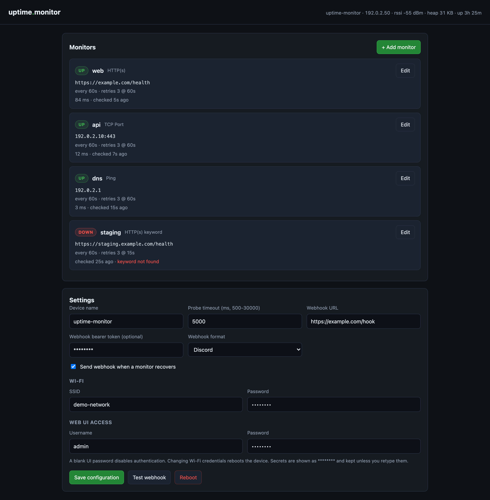

# uptime-monitor

An Uptime Kuma-style monitor that runs entirely on a single ESP8266: it probes
HTTP endpoints, TCP ports and ICMP, keeps the monitor/retry state machine on the
device, and POSTs a webhook when something goes down.

<p align="center">
  
</p>

<p align="center"><em>The web UI, shown with dummy monitors.</em></p>

## What it does

- **HTTP(S) monitor** — `GET` a URL; configurable accepted status codes,
  redirect following, and an optional body keyword assertion (Kuma's
  "HTTP(s) - Keyword").
- **TCP port monitor** — full TCP handshake to `host:port`.
- **Ping monitor** — one ICMP echo via the lwIP raw API (`ESP8266Ping`).
- **Per-monitor scheduling** — heartbeat interval, retries, heartbeat retry
  interval, resend cadence, upside-down mode, enable/notify flags, and a
  per-monitor request timeout.
- **Webhook on state change** — generic JSON or a native **Discord** payload,
  optional bearer token, bounded retry with backoff, recovery notification.
- **Web UI on the device** — add/edit/delete monitors, set every field, test the
  webhook, reboot, optional HTTP basic auth.
- **Setup access point** — first boot with no Wi-Fi credentials starts
  `uptime-monitor` / `uptime1234` at `http://192.168.4.1`.
- **Status LED** — slow heartbeat when everything is up, fast blink when any
  monitor is DOWN.

## Kuma semantics (exactly as in the monitor form)

| Field | Behaviour |
|---|---|
| Heartbeat Interval | Cadence while UP and while DOWN. |
| Retries | Consecutive failures tolerated. The monitor becomes **DOWN** on failure number `retries + 1`; until then it is **Pending**. |
| Heartbeat Retry Interval | Cadence used while retries are in flight (Pending). |
| Resend if down X times | While DOWN, repeat the webhook every `X` failed beats. `0` disables resends. |
| Upside down mode | A *reachable* target is reported DOWN; an unreachable one is UP. |
| Send webhook | Per-monitor attach switch. |
| Enabled | Disabled monitors are shown but never scheduled. |
| Request timeout | Per-monitor override in ms; `0` inherits the device-wide `timeout_ms`. |
| Accepted status codes | `200-299` by default; comma-separated codes or ranges (`200,204,301-302`). |
| Max redirects | Follow 3xx `Location` up to N hops. `0` disables following. |
| Keyword (HTTP) | When set, the response body must contain it or the monitor is DOWN. |

Note the cadence split: once DOWN, checks continue at the **heartbeat interval**
(not the retry interval). The retry interval only applies to the Pending window.

## Build, test, flash

Requires PlatformIO (a project-local venv keeps it out of the system Python):

```sh
python3 -m venv .venv
. .venv/bin/activate
pip install platformio

pio test -e native              # host unit tests: scheduler + config codec
pio run -e nodemcuv2            # firmware
pio run -e nodemcuv2 -t upload --upload-port <PORT>
pio run -e nodemcuv2 -t uploadfs --upload-port <PORT>   # seed data/config.json
pio device monitor -b 115200
```

Some CH340-based boards (especially behind a USB hub) corrupt long transfers at
higher baud rates. If a flash dump or upload fails, drop to 115200.

## First run

With no Wi-Fi credentials stored, the board boots into setup mode:

1. Join the access point: SSID `uptime-monitor`, password `uptime1234`.
2. Open `http://192.168.4.1`.
3. Under **Settings**, enter your Wi-Fi SSID/password and save. The device
   reboots onto your network and starts probing.
4. Find the address from the serial log, mDNS (`http://<device-name>.local`), or
   your router's DHCP table.
5. Set a UI password in **Settings** if the LAN is not trusted.

If the credentials are wrong, the device retries for 20 s and brings the setup
AP back so you can correct them.

To provision monitors up front, copy `data/config.example.json` to
`data/config.json`, edit it, and run `pio run -e nodemcuv2 -t uploadfs`.

## Webhook payload

```json
{
  "event": "down",
  "status": "down",
  "monitor": "web",
  "id": 1,
  "type": "tcp",
  "target": "192.0.2.10:22",
  "failures": 4,
  "latency_ms": 0,
  "http_status": 0,
  "error": "tcp connect failed",
  "time": "2026-10-24T12:34:56Z",
  "uptime_s": 1234,
  "device": "uptime-monitor",
  "ip": "192.0.2.50"
}
```

`event` is `down`, `up` or `resend`. `time` falls back to `uptime:<seconds>` until
NTP syncs. `http_status` is only present for HTTP monitors.

With `"format": "discord"` the device sends Discord's native shape instead:

```json
{
  "username": "uptime-monitor",
  "content": "[DOWN] **web** (tcp)\n`192.0.2.10:22`\nFailure 4 - tcp connect failed\nDevice: uptime-monitor (192.0.2.50)\nTime: 2026-10-24T12:34:56Z",
  "allowed_mentions": { "parse": [] }
}
```

`allowed_mentions.parse` is intentionally empty so a monitor name can never ping
`@everyone` or a role. Discord returns `204` on success, which the device treats
as delivered.

## HTTP API

| Method | Path | Purpose |
|---|---|---|
| GET | `/` | Web UI (PROGMEM). |
| GET | `/api/state` | Device + live monitor state. Polled by the UI every 3 s. |
| GET | `/api/config` | Full config; `wifi.pass`, `webhook.token`, `ui.pass` masked as `********`. |
| POST | `/api/config` | Replace config. Masked secrets mean "keep current". Validates, persists, carries runtime state for unchanged monitors. |
| POST | `/api/test-webhook` | Queue a synthetic DOWN event. Poll `/api/state` for `test_webhook` = `queued`/`sent`/`failed`. |
| POST | `/api/reboot` | Reboot. |

Config document (this is also the import/export format):

```json
{
  "version": 1,
  "device_name": "uptime-monitor",
  "wifi": { "ssid": "", "pass": "" },
  "webhook": { "url": "https://example.com/hook", "token": "", "format": "generic", "notify_on_recovery": true },
  "ui": { "user": "", "pass": "" },
  "timeout_ms": 5000,
  "monitors": [
    {
      "id": 1, "name": "app", "type": "tcp",
      "host": "192.0.2.10", "port": 22,
      "interval": 60, "retries": 3, "retry_interval": 60,
      "resend_every": 0, "upside_down": false, "notify": true,
      "enabled": true, "description": ""
    },
    {
      "id": 2, "name": "site", "type": "http",
      "url": "https://example.com/health",
      "interval": 60, "retries": 3, "retry_interval": 15,
      "resend_every": 0, "upside_down": false, "notify": true, "enabled": true
    }
  ]
}
```

For HTTP monitors `url` is authoritative and is parsed into host/port/path/https.
`type` is `http`, `tcp` or `ping`.

Additional HTTP fields: `keyword`, `accepted_status` (default `200-299`),
`max_redirects` (default `5`) and `timeout_ms` (0 = inherit). The webhook object
accepts `"format": "generic"` or `"format": "discord"`.

### Seeding the device

Copy `data/config.example.json` to `data/config.json`, edit it, and flash it with
`pio run -e nodemcuv2 -t uploadfs`. `data/config.json` is gitignored because it
contains Wi-Fi credentials, the webhook secret and your monitor inventory; the
firmware validates it with the same codec used by the host tests, so a malformed
seed is rejected before it can reach the device. Never commit a real config.

## Limits and honest constraints

- **HTTPS certificates are not validated.** Probes and webhooks use BearSSL's
  `setInsecure()`. A green HTTPS status means "handshake + HTTP response worked",
  *not* "the certificate is valid". Certificate pinning is not implemented.
- **One TLS connection at a time.** BearSSL allocates an 8 KB receive buffer
  (~9 KB heap with contexts) per connection. Checks are strictly sequential;
  many HTTPS monitors on this chip will exhaust the heap.
- **12 monitors by default.** Override with
  `-DUM_MAX_MONITORS=<n>` in `platformio.ini`. Each slot costs roughly 440 bytes
  of static RAM plus JSON document space while saving config. With five monitors
  the measured free heap after boot is about **35 KB**. A TLS probe uses an 8 KB
  BearSSL receive buffer (~9 KB including contexts) and refuses to start below
  20 KB free heap, reporting `low heap for tls` instead of risking the heap.
  Don't add many HTTPS monitors on this chip.
- **TLS 1.0–1.2 only.** BearSSL on the ESP8266 cannot negotiate TLS 1.3, and the
  TLS handshake has a 15 s ceiling (the core's own default). A server that
  requires TLS 1.3 cannot be monitored over HTTPS by this device.
- **Webhook URL length.** The stored URL is capped at 191 characters. Discord's
  `/api/webhooks/<id>/<token>` fits comfortably; very long signed URLs may not.
- **Status is RAM-only.** Config and monitor definitions persist in LittleFS;
  live state does not. A reboot returns every monitor to Pending and checks
  immediately (staggered by 250 ms per monitor).
- **Webhook queue:** 6 events, 4 delivery attempts at 4/8/16 s backoff, then the
  event is dropped. If Wi-Fi is down the queue holds events and flushes on
  reconnect — but a reboot loses them.
- **Same-network blind spot.** The device reports failures over the same Wi-Fi it
  depends on. If the link drops, checks fail and alerts cannot leave until it
  returns. A dead-man's-switch heartbeat to an external collector is the right
  fix and is not implemented here.
- **No UDP monitor.** This was deliberately built as a **TCP port** monitor, per
  the Kuma form. A UDP "port open" check is not feasible on the ESP8266: lwIP
  does not surface ICMP port-unreachable, so a closed port looks identical to a
  silently dropping one.
- **The UI is plain HTTP.** Basic auth protects it only against casual access;
  credentials cross the LAN in cleartext. Do not expose it to the internet.
- **Probes are synchronous.** A slow TLS handshake (up to ~12 s) or webhook
  delivery (up to ~18 s worst case) blocks the web server for that long. With
  many HTTPS monitors the UI can feel unresponsive; checks are never concurrent.
- **Checks pause without a station link.** Probes only run when the ESP is
  associated with your Wi-Fi. During AP-only setup nothing is marked DOWN, which
  avoids false alerts (and pointless webhook retries) when the device itself has
  no uplink.
- **HTTP keyword search** reads at most 16 KB of the response body and matches
  on the raw stream. A keyword split across HTTP chunk boundaries could be
  missed; keep assertions short and distinctive.
- **Redirects** support absolute URLs, protocol-relative (`//host/path`) and
  root-relative (`/path`) `Location` values. Relative paths without a leading
  slash are rejected.
- **Ping sends one packet** per check and counts DNS/handshake time inside the
  probe timeout.
- **Flash wear:** config is written only when you save, never per check.

## Layout

```
docs/
  web-ui.png             README screenshot (dummy data)
lib/uptime_core/       portable, host-testable core
  monitor.h              POD data model (fixed buffers, no String)
  scheduler.{h,cpp}      Kuma retry state machine + notification queue
  config_codec.{h,cpp}   URL parsing, JSON config, validation
src/
  main.cpp               Wi-Fi/AP, web server, scheduler loop, webhook queue
  checks.{h,cpp}         TCP / HTTP / ICMP probes, webhook POST
  webui.h                single-page UI (PROGMEM)
test/
  test_scheduler/        13 host tests
  test_config/           14 host tests
  test_seed/             validates a local data/config.json if present
```
